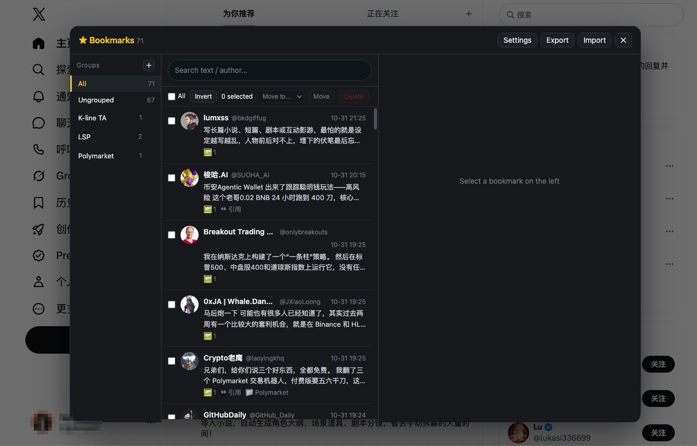

# X Bookmark Vault

**One-click snapshots of any X/Twitter post into a local, searchable, exportable vault.**
No Premium. No account. No server. One `.user.js` file.

[简体中文](README.zh-CN.md) · **English**

[](https://raw.githubusercontent.com/gpboyer2/x-bookmark-vault/main/x-bookmark.user.js)
[](https://www.tampermonkey.net/)
[](LICENSE)
[](https://github.com/gpboyer2/x-bookmark-vault/stargazers)



<sub>English UI mock-up. The shipped script currently speaks Chinese only — <a href="docs/screenshot-zh.png">here is what it really looks like</a>. An English UI is on the roadmap.</sub>

---

## Why this exists

X's built-in bookmarks are a dead end:

- **You can't sort them into folders** unless you pay for Premium.
- **You can't search them.** There is no "find that thread I saved in March" button.
- **They disappear.** When the author deletes the post, locks the account, or the post gets moderated, your bookmark becomes a broken placeholder — the reason you saved it is gone.

X Bookmark Vault turns bookmarks into an actual library: it **takes a snapshot of the post at the moment you save it** and keeps everything on your own machine.

## Features

- **☆ One-click snapshot.** Every post in your timeline gets a star button. One click stores the text, author, handle, timestamp, engagement counts, image/video links, the quoted tweet, and the replies that were already loaded on the page.

- **Long-form posts, full text.** X Articles and `note_tweet` long posts are captured in full, not truncated at the fold.

- **Quoted tweets, both versions.** The quoted post is stored with its text, its original-language text where available, and its media links.

- **Local-first storage.** Everything lives in your browser's IndexedDB. No server, no login, no telemetry. Delete your browser data and it's gone — export first.

- **Groups without Premium.** Create folders, drag posts into them, batch-move forty posts in two clicks. Deleting a group never deletes the posts inside it.

- **Instant search.** Type in the search box and the list filters by post text or author as you type.

- **Batch operations.** Select all / invert selection / bulk move / bulk delete, with a two-step confirm on destructive actions.

- **JSON in, JSON out.** Export the whole library as one JSON file, import it on another machine: merged by post ID, and whichever copy was updated last wins.

- **Deletion-proof reading pane.** Full text, media grid with click-to-zoom, quoted tweet, engagement stats, reply snapshots, and a link back to the original post.

- **Bonus: ad cleanup.** Toggles that hide promoted posts and promoted trends on your home timeline.

- **Built to survive redesigns.** Every DOM selector lives in a single `CONFIG.SEL` block, and the panel re-attaches itself when X re-renders the timeline.

## Install

1. Install **Tampermonkey** for your browser — [Chrome](https://chromewebstore.google.com/detail/tampermonkey/dhdgffkkebhmkfjojejmpbldmpobfkfo) · [Edge](https://microsoftedge.microsoft.com/addons/detail/tampermonkey/iikmkjmpaadaobahmlepeloendndfphd) · [Firefox](https://addons.mozilla.org/firefox/addon/tampermonkey/) · [Safari](https://apps.apple.com/app/tampermonkey/id1482490089).

2. **→ [Install the script](https://raw.githubusercontent.com/gpboyer2/x-bookmark-vault/main/x-bookmark.user.js)** — Tampermonkey opens its install page. Click *Install*.

3. Open [x.com](https://x.com) (or twitter.com). A round star button appears on the right edge of the page.

That's it. No configuration, no API key, no account to link.

## Usage

| What | How |
| --- | --- |
| Open the library | Click the round button on the right edge, or the Tampermonkey menu item *打开收藏库* |
| Save a post | Click the `☆` at the top-right of any post — or *收藏当前页这条帖子* from the Tampermonkey menu |
| Save the whole thread | Open the post detail page first, then save — the replies already loaded are snapshotted with it (up to 60) |
| Group | Left column: `+` creates a group, drag a post onto a group to move it |
| Batch move / delete | Tick the boxes, then use the selection bar |
| Export / import | Header buttons `导出` / `导入` — JSON, all-of-library, merge on import |
| Exit | `Esc` or the `✕` button, or click outside the panel |

> The interface ships in Chinese (简体中文). English UI is on the roadmap — pull requests welcome.

## Data layout

Each saved post is a plain object — easy to post-process with your own scripts:

```jsonc
{
  "id": "1800000000000000000",
  "url": "https://x.com/user/status/...",
  "author": { "name": "…", "handle": "…", "avatar": "…" },
  "createdAt": "2024-05-01T12:00:00.000Z",
  "savedAt": "2024-05-02T08:00:00.000Z",
  "updatedAt": "…",
  "text": "full post text, including long-form body",
  "textOriginal": "pre-translation text, when X auto-translated",
  "media": [{ "url": "…", "thumb": "…", "alt": "…", "type": "photo|video" }],
  "quote": { "author": {…}, "text": "…", "textOriginal": "…", "media": [...] },
  "replies": [{ "author": {…}, "text": "…", "createdAt": "…" }],
  "stats": { "replies": 12, "reposts": 40, "likes": 310, "views": 20000 },
  "group": "K-line TA",
  "tags": [],
  "note": ""
}
```

## FAQ

**Do I need X Premium?** No. The script works on the normal web client with your existing session.

**Does it phone home?** No network calls of its own. It only reads the page you're already looking at; the media grid loads thumbnails straight from X's CDN.

**What happens when a post is deleted on X?** The text, author, counts and reply snapshot you saved stay in your library. Media are stored as *links*, so those thumbnails may break — text does not.

**Where is the data?** IndexedDB in your browser profile (settings go through Tampermonkey's `GM_setValue`). Uninstalling the script or clearing site data wipes it, so export JSON if it matters.

**Can I sync between machines?** Export JSON on one machine and import on the other. Import merges by post ID.

**Will X break it?** X changes its DOM regularly. Selectors are centralized in one config block and the UI self-heals, but if something stops working, open an issue with the browser version — fixes are usually a one-line diff.

**Why a userscript instead of a browser extension?** One file you can read end-to-end before you run it, no store review, no permissions prompt for `*://*/*`. You can audit every line that touches your data.

## Limitations

- Interface language is Chinese only, for now.
- Media are linked, not downloaded — the library is text-and-metadata-first.
- Reply snapshots cover only the replies X had already rendered on the post page (configurable, default 60).
- This is a personal archiving tool. Respect the people whose posts you keep, and X's terms.

## Contributing

Bug reports, selector fixes and translations are all welcome — the whole thing is one file, `x-bookmark.user.js`. Open an issue with: what you clicked, what you expected, what happened, and your browser + Tampermonkey version.

If this saved you from losing a post you cared about, a ⭐ on the repo helps other people find it.

## License

[MIT](LICENSE)
