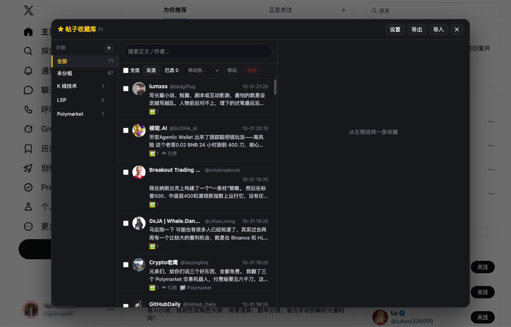

# X 帖子收藏库 · X Bookmark Vault

**一键把 X/Twitter 的任意帖子快照进你本机的收藏库：能分组、能搜索、能导出。**
不要会员、不要账号、不要服务器 —— 只有一个 `.user.js` 文件。

**简体中文** · [English](README.md)

[](https://raw.githubusercontent.com/gpboyer2/x-bookmark-vault/main/x-bookmark.user.js)
[](https://www.tampermonkey.net/)
[](LICENSE)
[](https://github.com/gpboyer2/x-bookmark-vault/stargazers)



---

## 为什么还要再做一个收藏工具

X 自带的书签，基本是个死胡同：

- **不买会员就不能分组。** 收藏几百条以后就是一团乱麻。
- **不能搜索。** 没有"帮我找三月存下的那条长帖"这种按钮。
- **会消失。** 作者删帖、锁推、被处理，你存的书签就变成一个打不开的空壳 —— 当初想留它的理由一起没了。

所以这个脚本做的是另一件事：**在你点收藏的那一刻，把帖子的快照存下来**，全部留在你自己的电脑里。

## 功能

- **☆ 一键快照。** 时间线上每一条帖子右上角都有一个星标按钮，点一下就把正文、作者、ID、时间、互动数据、图片/视频链接、被引用的帖子、以及页面上已经加载出来的评论一起存下来。

- **长文全文。** X 的长文（Articles）和 `note_tweet` 长帖会抓完整正文，不会在"展开"处被截断。

- **引用帖双份留存。** 被引用的帖子会连同正文、原文（X 自动翻译过的话两份都留）、以及它的媒体链接一起存。

- **本地优先。** 数据全在浏览器 IndexedDB 里：没有服务器、不用登录、没有埋点。清掉浏览器数据就没了，所以要留就先导出 JSON。

- **免会员分组。** 左栏可以新建分组、把帖子拖进去、四十几条一起批量移动。删掉分组不会连帖子一起删。

- **边打边搜。** 搜索框里输入，列表实时按正文或作者过滤。

- **批量操作。** 全选 / 反选 / 批量移动 / 批量删除，破坏性操作都要点两下确认。

- **JSON 进，JSON 出。** 整个库导出成一个 JSON，在另一台机器上导入：按帖子 ID 合并，谁更新得晚听谁的。

- **删不掉的阅读窗格。** 完整正文、可点击放大的图片墙、引用帖、互动数据、评论快照，以及一个跳回原帖的入口。

- **顺手清广告。** 可以开关：隐藏首页时间线上的推广帖与推广趋势。

- **扛得住改版。** 所有 DOM 选择器集中在同一个 `CONFIG.SEL` 里，X 重渲染时间线时面板会自己挂回去。

## 安装

1. 先装 **Tampermonkey**：[Chrome](https://chromewebstore.google.com/detail/tampermonkey/dhdgffkkebhmkfjojejmpbldmpobfkfo) · [Edge](https://microsoftedge.microsoft.com/addons/detail/tampermonkey/iikmkjmpaadaobahmlepeloendndfphd) · [Firefox](https://addons.mozilla.org/firefox/addon/tampermonkey/) · [Safari](https://apps.apple.com/app/tampermonkey/id1482490089)。

2. **→ [点这里安装脚本](https://raw.githubusercontent.com/gpboyer2/x-bookmark-vault/main/x-bookmark.user.js)**，Tampermonkey 会弹出安装页，点"安装"。

3. 打开 [x.com](https://x.com)（或 twitter.com），页面右侧会出现一个圆形星标按钮。

不用配置、不用填 API Key、不用绑定账号。

## 怎么用

| 想做什么 | 怎么操作 |
| --- | --- |
| 打开收藏库 | 点页面右边缘那个圆形按钮，或在 Tampermonkey 菜单里选「打开收藏库」 |
| 收藏一条帖子 | 点帖子右上角的 `☆`，或菜单里选「收藏当前页这条帖子」 |
| 连评论一起存 | 先点开帖子详情页再收藏，页面上已加载的评论会一起快照（默认最多 60 条） |
| 分组 | 左栏 `+` 新建分组，把帖子拖到分组上即可移动 |
| 批量移动 / 删除 | 勾选复选框，用上方选择条操作 |
| 导出 / 导入 | 面板右上角「导出」「导入」，JSON 格式，导出永远是整库，导入按 ID 合并 |
| 关闭 | `Esc`、`✕` 按钮，或点面板外面的遮罩 |

> 界面目前只有简体中文。英文界面在计划里，欢迎 PR。

## 数据结构

每条收藏就是一个普通对象，方便你自己写脚本二次处理：

```jsonc
{
  "id": "1800000000000000000",
  "url": "https://x.com/user/status/...",
  "author": { "name": "…", "handle": "…", "avatar": "…" },
  "createdAt": "2024-05-01T12:00:00.000Z",
  "savedAt": "2024-05-02T08:00:00.000Z",
  "updatedAt": "…",
  "text": "完整正文（长文也在这里）",
  "textOriginal": "X 自动翻译时保留的原文",
  "media": [{ "url": "…", "thumb": "…", "alt": "…", "type": "photo|video" }],
  "quote": { "author": {…}, "text": "…", "textOriginal": "…", "media": [...] },
  "replies": [{ "author": {…}, "text": "…", "createdAt": "…" }],
  "stats": { "replies": 12, "reposts": 40, "likes": 310, "views": 20000 },
  "group": "K 线技术",
  "tags": [],
  "note": ""
}
```

## 常见问题

**要 X 会员吗？** 不要。用的就是你网页版当前的登录态。

**会往外发数据吗？** 不会。脚本自己不发任何请求，只读你正在看的页面；图片墙里的缩略图是从推特图床直接加载的。

**原帖在 X 上被删了怎么办？** 你存下来的正文、作者、互动数、评论快照都还在库里。图片只存了链接，所以缩略图可能会失效，正文不会。

**数据存在哪？** 浏览器配置里的 IndexedDB（设置项走 Tampermonkey 的 `GM_setValue`）。卸载脚本或清理站点数据会一起清掉，要紧的话先导出 JSON。

**两台机器能同步吗？** 一台导出 JSON，另一台导入，按帖子 ID 合并。

**X 改版会不会挂？** X 的 DOM 改得很勤。选择器都集中在一个配置块里、面板也会自愈，但真挂了就到 issue 里报一下浏览器版本，通常是一行 diff 的事。

**为什么做成油猴脚本，而不是浏览器扩展？** 因为一个文件你可以从头读到尾再决定跑不跑：不用过商店审核，也不用给 `*://*/*` 这种权限。碰你数据的每一行都看得见。

## 已知局限

- 界面目前只有中文。
- 图片存的是链接，不是文件 —— 这个库是"正文与元数据优先"的。
- 评论快照只覆盖帖子详情页上已经渲染出来的评论（可配置，默认 60 条）。
- 这是个个人存档工具。请尊重被你收藏的作者的意愿，也遵守 X 的条款。

## 参与贡献

报 bug、修选择器、加翻译都欢迎 —— 全部代码就一个文件：`x-bookmark.user.js`。提 issue 时写清三件事：点了什么、期望是什么、实际是什么，再加上浏览器和 Tampermonkey 版本。

如果它帮你留住了某条差点弄丢的帖子，给个 ⭐ 能让更多人翻到它。

## 许可证

[MIT](LICENSE)
